```{r child = "setup.Rmd"}

```

```{r xaringan-tile-view, echo=FALSE}
xaringanExtra::use_tile_view()
```

```{r xaringan-editable, echo=FALSE}
xaringanExtra::use_editable(expires = 1)

```

```{r xaringanExtra-clipboard, echo=FALSE}
htmltools::tagList(
  xaringanExtra::use_clipboard(
    button_text = "<i class=\"fa fa-clipboard\"></i>",
    success_text = "<i class=\"fa fa-check\" style=\"color: #90BE6D\"></i>",
    error_text = "<i class=\"fa fa-times-circle\" style=\"color: #F94144\"></i>"
  ),
  rmarkdown::html_dependency_font_awesome()
)
```

```{r xaringan-fit-screen, echo=FALSE}
xaringanExtra::use_fit_screen()

```

```{r xaringan-extra-styles, echo=FALSE}
xaringanExtra::use_extra_styles(
  hover_code_line = TRUE,         #<<
  mute_unhighlighted_code = TRUE  #<<
)
```

```{r xaringan-scribble, echo=FALSE}
xaringanExtra::use_scribble()
```

---
class: center, middle

# O que é Geomarketing?

.large[
> "Geomarketing é a integração de **inteligência geográfica** ao processo de
> planejamento e decisão de marketing."
]

.footnote[Oliveira, P.H.P. de. *Geointeligência*, 2024.]

---

## Agenda — Unidade 1 (4h)

.pull-left[
**Parte 1 (2h)**
- Conceito e evolução do geomarketing
- Relação com disciplinas afins
- O espaço como variável estratégica
- Principais aplicações
- Fundamentos de cartografia e representação geográfica

**Parte 2 (2h)**
- Fontes de dados introdutórias
- Demonstração: QGIS — primeiros passos
- Atividade prática em sala
]

.pull-right[
<iframe width="100%" height="320" frameborder="0" scrolling="no" marginheight="0" marginwidth="0"
  src="https://www.openstreetmap.org/export/embed.html?bbox=-43.9465%2C-19.9308%2C-43.9265%2C-19.9108&amp;layer=mapnik&amp;marker=-19.9208%2C-43.9365"
  style="border:1px solid #ccc">
</iframe>
<br>
<small>Localização: CEFET-MG – Campus II (Belo Horizonte)</small>
]

---

## O que é Geomarketing?

Geomarketing é a **disciplina** que combina:

| Área | Contribuição |
|------|-------------|
| **Marketing** | Segmentação, comportamento do consumidor, estratégia |
| **Geografia** | Localização, território, espaço relacional |
| **Estatística** | Análise de padrões, modelos preditivos |
| **SIG** | Coleta, armazenamento, visualização e análise espacial |

.tip[
**Por que o espaço importa?** Consumidores não estão uniformemente distribuídos — nem suas necessidades, nem sua renda, nem sua mobilidade.
]

---

## Evolução Histórica

.pull-left-wide[
**Linha do tempo**

- **Anos 1960**: Primeiros modelos de localização de varejo (Christaller, Huff)
- **Anos 1980**: SIG comerciais — MapInfo, Arc/Info
- **Anos 1990**: Difusão do GPS e dados censitários digitais
- **Anos 2000**: Google Maps, mashups e dados de mobilidade
- **Anos 2010**: Big Data espacial, redes sociais georreferenciadas
- **Anos 2020**: IA preditiva, dados de IoT, privacidade como pauta
]

.pull-right-narrow[
.green[
**Marcos**
📍 Modelo de Huff (1963)
📍 ESRI fundada (1969)
📍 GPS civil (1983)
📍 Google Maps (2005)
📍 LGPD Brasil (2020)
]
]

---

## Relação com o Marketing Clássico

Os **4 Ps** ganham dimensão espacial:

.pull-left[
- **Produto**: quais produtos têm demanda *onde*?
- **Preço**: poder de compra varia por território
- **Praça**: *onde* abrir? qual área de cobertura?
- **Promoção**: qual canal por microterritório?
]

.pull-right[
**Relevância Espacial por P** (intensidade 1–5)

| P | Intensidade |
|---|---|
| Praça | ●●●●● (5) |
| Preço | ●●●●○ (4) |
| Produto | ●●●○○ (3) |
| Promoção | ●●●○○ (3) |
]

---

## Aplicações por Setor

.pull-left[
**Varejo e Serviços**
- Localização de lojas e franquias
- Definição de área de cobertura de entrega
- Análise de canibalização entre unidades

**Setor Público**
- Planejamento de equipamentos de saúde e educação
- Rotas de coleta e logística urbana
- Zoneamento e uso do solo
]

.pull-right[
**Organizações Sociais**
- Mapeamento de vulnerabilidade social
- Planejamento de campanhas comunitárias
- Alocação de recursos em territórios prioritários

**Marketing Digital**
- Geofencing e notificações por proximidade
- Segmentação de anúncios por bairro/CEP
- Análise de fluxo de clientes (footfall)
]

---

## Case: Expansão de Rede de Franquias

.question[
Como uma rede de farmácias decide *onde* abrir sua próxima loja em Belo Horizonte?
]

**Variáveis espaciais consideradas:**

1. Densidade populacional e perfil etário por setor censitário
2. Renda domiciliar média (Censo 2022)
3. Distância das unidades existentes (análise de canibalização)
4. Concorrentes mapeados via OpenStreetMap
5. Acessibilidade por transporte público (BHTRANS GTFS)

---
class: center, middle

# Fundamentos de Cartografia e Representação Geográfica

.large[
Antes de tratar dados espaciais, precisamos entender **como o espaço é representado** — da forma da Terra até o mapa na tela.
]

.footnote[Baseado em OLIVEIRA, R. *Geocomputing e Análise Espacial* — [places.education/cursos/spatial/localizacao](https://www.places.education/cursos/spatial/localizacao/)]

---

## Pensamento Espacial

.pull-left[
.large[
> "Todas as coisas são parecidas, mas coisas mais próximas se parecem mais que coisas mais distantes."
]

— Waldo Tobler (1ª Lei da Geografia)

**Pensar espacialmente** é:
- Encontrar significado em forma, tamanho, orientação, localização, direção ou trajetória de objetos, processos e fenômenos
- Encontrar significado na **localização relativa** de múltiplos objetos, processos e fenômenos
]

.pull-right[
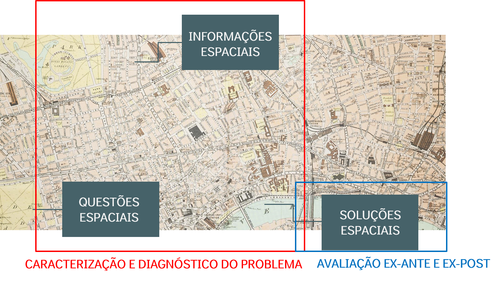

**Perguntas espaciais típicas:**
- O que existe em uma determinada localização?
- Onde posso encontrar um determinado objeto?
- O que mudou ao longo do tempo?
- Qual o melhor caminho?
- Como os objetos são distribuídos no espaço?
]

---

## A Forma da Terra: o Geoide

.pull-left[
**Geoide:** superfície delimitada pelo nível médio dos mares, supostamente prolongado por sob os continentes — forma irregular, com ondulações e depressões.

É preciso buscar um modelo mais simples para representar a Terra: o **elipsoide**, modelo matemático que define a superfície terrestre.
]

.pull-right[
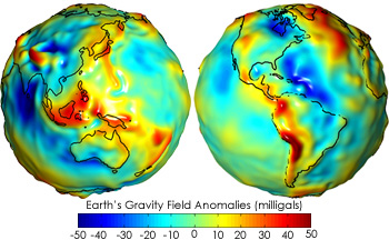
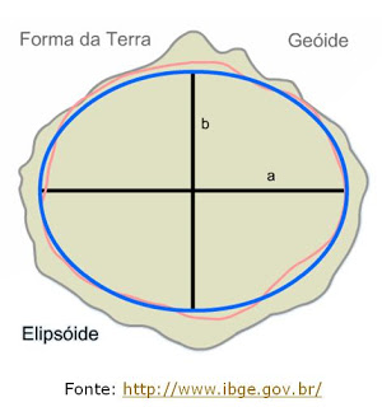
]

---

## Elipsoide de Revolução

.pull-left[
Ao girar em torno de seu eixo menor, uma **elipse** forma um volume achatado nos polos — é a figura matemática que mais se aproxima da forma do geoide, com parâmetros simples:

| Símbolo | Significado |
|---|---|
| `a` | semi-eixo maior |
| `b` | semi-eixo menor |
| `f` | achatamento = (a−b)/a |

.tip[
Cada país (ou grupo de países) adota o elipsoide de referência que melhor se aproxima do geoide na sua região.
]
]

.pull-right[
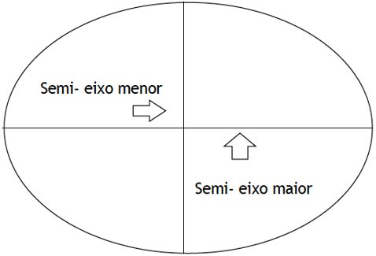
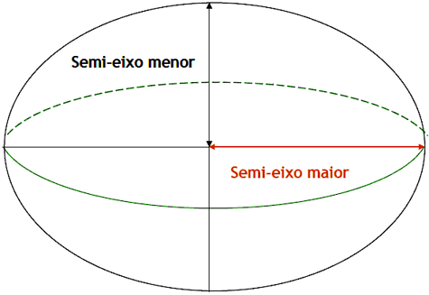
]

---

## Sistemas Geodésicos e Datum

.large[
Um **sistema geodésico** permite estabelecer uma relação entre um ponto do terreno e um elipsoide de referência, elegendo o elipsoide que melhor se ajusta às características locais do geoide.
]

A posição desse elipsoide em relação à Terra, sua forma e tamanho constituem o **Datum Geodésico**: marco geodésico (horizontal ou vertical) usado como ponto de origem do sistema geodésico.

.pull-left[
- **Datum Vertical/Altimétrico:** referência para altitude (marco "zero")
- **Datum Horizontal/Planimétrico:** referência para coordenadas planimétricas
]

.pull-right[
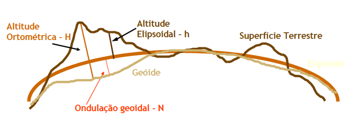
]

---

## Datum Geocêntrico × Topocêntrico

.pull-left[
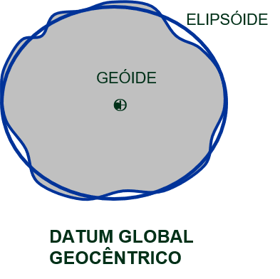
]

.pull-right[
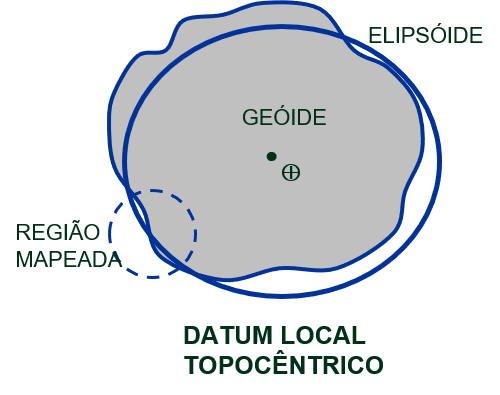
]

.tip[
**SIRGAS 2000** — Sistema de Referência Geocêntrico para as Américas: datum global, geocêntrico (EPSG:4674) — o padrão oficial do Brasil, usado em todas as camadas deste curso.

**SAD-69** — Sistema Geodésico Sul-Americano 1969: datum local, topocêntrico (ainda encontrado em bases antigas).
]

---

## Sistemas de Coordenadas Geográficas

.large[
Necessários para expressar a posição de pontos sobre uma superfície curvilínea (elipsoide/esfera): cada ponto é localizado na interseção de um **meridiano** e um **paralelo**.
]

.pull-left[
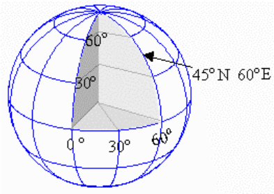
]

.pull-right[
**Meridianos** — semicírculos gerados pela interseção de planos verticais (contendo o eixo de rotação) com a superfície terrestre. O meridiano de origem é **Greenwich**: a leste, valores de 0° a +180°; a oeste, de 0° a −180°.

**Paralelos** — círculos cujo plano é perpendicular ao eixo dos polos. O **Equador** (0°) divide a Terra em hemisférios Norte/Sul; os polos são ±90°.
]

---

## Latitude e Longitude

.pull-left[
**Latitude (ϕ)**

Distância angular entre o lugar e o plano do Equador, contada sobre o plano do meridiano que passa no lugar. Varia de −90° a +90°.

**Longitude (λ)**

Distância angular entre o lugar e o meridiano de origem, contada sobre um plano paralelo ao Equador. Varia de −180° a +180°.
]

.pull-right[
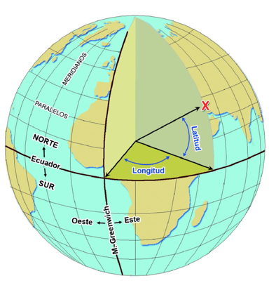
]

---

## Projeções Cartográficas

.large[
Para confeccionar um mapa, cada ponto da superfície terrestre precisa corresponder a um ponto do mapa (e vice-versa): o **sistema de projeções**.
]

A projeção cartográfica transforma uma posição na Terra (latitude/longitude) em uma posição em coordenadas cartesianas/planas (x, y).

.pull-left[
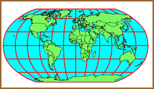
]

.pull-right[
.tip[
Coordenadas planas servem para representar **pequenas porções** da superfície (mapas de grande escala) — em mapas de pequena escala o potencial de distorção é maior.
]
]

---

## Toda Projeção Deforma Algo

.pull-left[
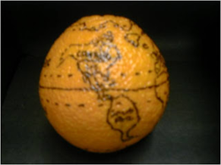
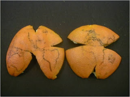
]

.pull-right[
Representar uma superfície curva (a Terra) em um plano sempre envolve deformação.

.tip[
**Não existe projeção ideal.** Toda projeção sacrifica alguma propriedade — ângulo, área ou distância.
]

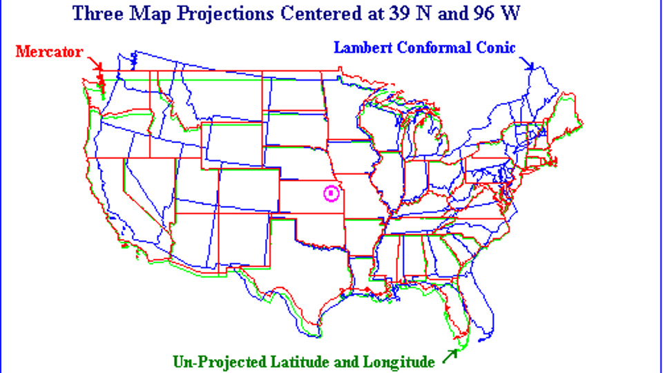
]

---

## Tipos de Projeção

| Tipo | O que preserva | O que deforma |
|---|---|---|
| **Conforme** | Ângulos/forma | Tamanhos |
| **Equidistante** | Distâncias | Áreas e ângulos |
| **Equivalente** | Áreas | Formas |
| **Afilática** | Nenhuma propriedade — busca reduzir distorções em geral | — |

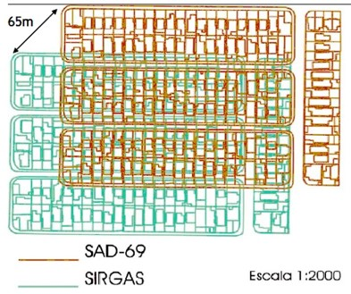

---

## Classificação das Projeções

.pull-left[
**Quanto à superfície de projeção:**
- Plana ou Azimutal
- Cilíndrica
- Cônica
- Polissuperficiais (poliédrica, policilíndrica, policônica)
]

.pull-right[
**Quanto ao tipo de contato:**

Tangente
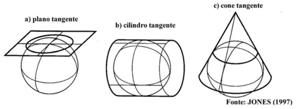

Secante
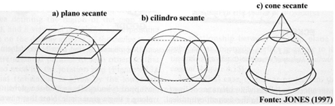
]

---

## Projeção UTM

.large[
**UTM** (Universal Transversa de Mercator): 60 cilindros transversos, cada um com 6° de amplitude em longitude — **60 fusos**, numerados a partir do antimeridiano de Greenwich. Cada fuso tem um meridiano central, com 3° para cada lado.
]

.pull-left[
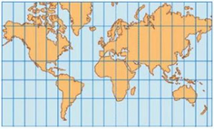
]

.pull-right[
- Unidade: **metro**
- Origem: Equador × Meridiano Central
- Hemisfério Sul: 10.000.000 m no Equador (N), decrescendo ao Sul; 500.000 m no Meridiano Central (E)
- Fusos no Brasil: **18 a 25**
- **Belo Horizonte: Fuso 23**
]

---

## Projeção UTM — Fusos

.pull-left[
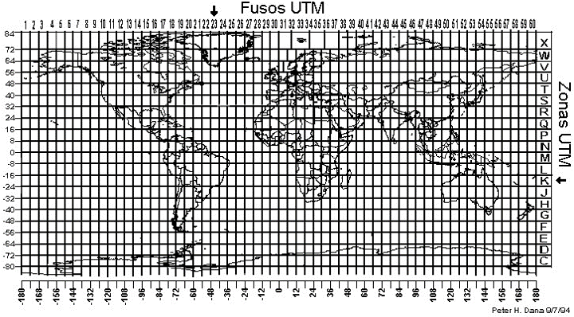
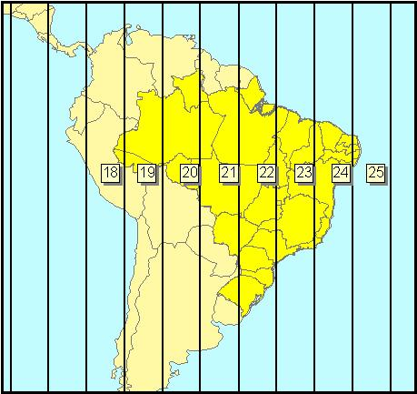
]

.pull-right[
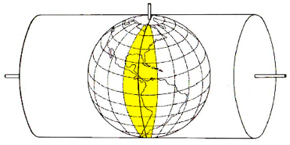
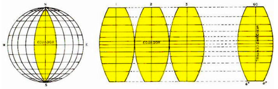
]

---

## Projeção UTM — Exemplo de Sobreposição de Fusos

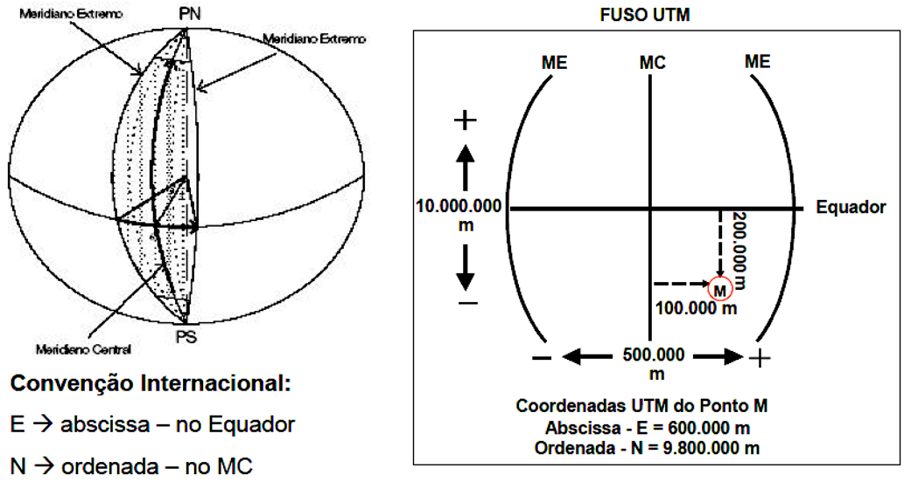

---

## O que é um SIG (GIS)?

.large[
**SIG** = Sistema de Informação Geográfica (*Geographic Information System*): conjunto de ferramentas para coleta e tratamento de informações espaciais, geração de mapas, relatórios e arquivos digitais — com recursos de armazenagem, gerenciamento, manipulação e análise.
]

.tip[
**Geoprocessamento** é um conceito mais amplo: qualquer tipo de processamento de dados georreferenciados. Um SIG processa dados gráficos e alfanuméricos, com ferramentas de análise espacial e modelagem de superfícies.
]

---

## Definições de GIS

.large[
> "Conjunto poderoso de ferramentas para coletar, armazenar, recuperar, transformar e visualizar dados sobre o mundo real." — **Burrough**
]

.large[
> "Um sistema de suporte à decisão que integra dados referenciados espacialmente num ambiente de respostas a problemas." — **Cowen**
]

.large[
> "Um banco de dados indexados espacialmente, sobre o qual opera um conjunto de procedimentos para responder a consultas sobre entidades espaciais." — **Smith**
]

---

## Por que Fazer Cartografia Digital?

.pull-left[
- Fazer mapas mais rapidamente e mais baratos
- Fazer mapas para usos específicos
- Fazer mapas mesmo sem pessoal especializado disponível
- Permitir experimentar representações diversas dos mesmos dados
]

.pull-right[
- Facilitar a atualização de mapas
- Facilitar análises que exigem interação entre estatística e mapas
- Minimizar a necessidade de mapas em papel
- Fazer mapas que não cabem no papel (ex.: 3D)
]

---

## Dados Espaciais: Vetor × Raster

.large[
Dados espaciais podem apresentar diferentes formatos e estruturas. Neste curso, usamos principalmente o formato **shapefile** (ESRI) para dados vetoriais.
]

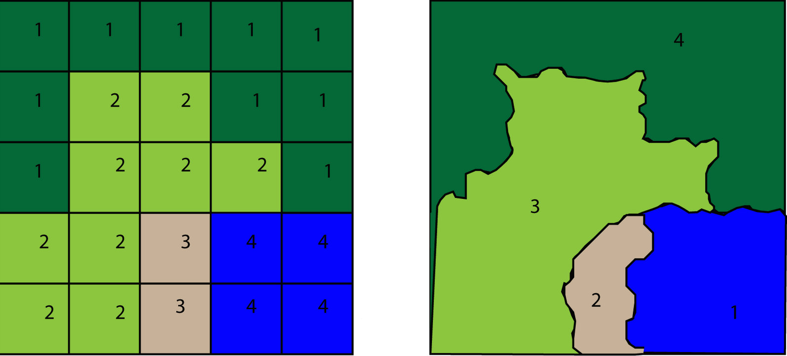

---

## Estrutura do Shapefile

| Extensão | Conteúdo |
|---|---|
| `.shp` | Geometria das feições |
| `.shx` | Índice da geometria — busca rápida |
| `.dbf` | Banco de dados — atributos das feições |
| `.prj` | Sistema de coordenadas geográficas |
| `.sbn` / `.sbx` | Índices espaciais das feições |
| `.xml` | Metadado em formato XML |

.tip[
Um shapefile é, na prática, um **conjunto de arquivos** — todos precisam estar na mesma pasta para o QGIS abrir a camada corretamente.
]

---

## Distâncias

.large[
Diferentes conceitos de distância representam a **impedância** entre funções/atividades urbanas (conectividade):
]

| Medida | Fórmula | Interpretação |
|---|---|---|
| **Euclidiana** | √((x₁−x₂)² + (y₁−y₂)²) | Segmento de reta entre dois pontos ("linha reta") |
| **Manhattan** | \|x₁−x₂\| + \|y₁−y₂\| | Segmentos vertical + horizontal (rota urbana em grade) |
| **Em rede** | (calculada sobre o grafo viário) | Deslocamento real no ambiente construído — mais próxima da realidade, porém mais exigente computacionalmente |

.tip[
Vamos calcular distâncias em rede no QGIS com o **ORS Tools** — ver Unidade 7 (Análise Espacial).
]

---

## Tipos de Representação Cartográfica

.large[
O mesmo dado espacial pode ser representado de formas diferentes — cada uma revela um padrão distinto:
]

| Representação | Ideia central |
|---|---|
| **Mapa coroplético** | Cores representam uma variável por área (ex.: renda por setor) |
| **Mapa de pontos** | Símbolos pontuais representam ocorrências (ex.: farmácias) |
| **Símbolos proporcionais** | Tamanho do símbolo varia conforme o valor |
| **Mapa de calor (densidade)** | Gradiente de cor mostra concentração |
| **Representação de fluxos** | Linhas mostram movimento entre origem e destino |
| **Cartograma** | Área é deformada proporcionalmente a uma variável |

.tip[
Vamos praticar cada um desses tipos no QGIS ao longo do curso — coropléticos e proporcionais já na Unidade 4, o conjunto completo na Unidade 6 (Cartografia Temática).
]

---

## Fontes de Dados — Introdução

.your-turn[
**Como obter malhas geográficas do IBGE (direto no QGIS):**

1. Acessar o site do IBGE — [Malhas Territoriais](https://www.ibge.gov.br/geociencias/organizacao-do-territorio/malhas-territoriais/15774-malhas.html)
2. Selecionar **Malha de Setores Censitários 2022** (ou "Municípios", conforme o nível desejado)
3. Escolher a UF (Minas Gerais) e baixar o arquivo em formato **shapefile** (`.shp`) ou **GeoPackage** (`.gpkg`)
4. Extrair o `.zip` baixado em uma pasta local (ex.: `dados/`)
5. No QGIS: *Camada → Adicionar Camada → Adicionar Camada Vetorial…* → selecionar o arquivo `.shp`/`.gpkg`
6. Repetir o processo para: municípios de MG, setores censitários de Belo Horizonte e regiões metropolitanas (disponíveis na mesma página do IBGE)
]

.tip[
**IBGE — Malhas Territoriais:** portal oficial com shapefiles/GeoPackages prontos para uso, atualizados a cada Censo — sem necessidade de código.
Site: [ibge.gov.br/geociencias](https://www.ibge.gov.br/geociencias/organizacao-do-territorio/malhas-territoriais.html)
]

---

## Fontes de Dados Secundários — Web

| Fonte | URL | Dados |
|-------|-----|-------|
| IBGE Malhas | [ibge.gov.br/geociencias](https://www.ibge.gov.br/geociencias/organizacao-do-territorio/malhas-territoriais.html) | Shapefiles/GeoPackage municipais/setoriais |
| IPEA Data | [ipeadata.gov.br](http://www.ipeadata.gov.br) | Indicadores socioeconômicos |
| OpenStreetMap | [overpass-turbo.eu](https://overpass-turbo.eu) | POI, vias, edifícios |
| dados.gov.br | [dados.gov.br](https://dados.gov.br) | Dados abertos federais |
| Google Places API | [developers.google.com](https://developers.google.com/maps/documentation/places) | Estabelecimentos comerciais |
| CNAE/RAIS | [portaldatransparencia.gov.br](https://portaldatransparencia.gov.br) | Empresas por atividade |

---

## QGIS — Primeiros Passos

**Objetivo:** Instalar, abrir um shapefile e visualizar municípios de MG.

.your-turn[
**Passo a passo (QGIS 3.x):**

1. Baixar QGIS em [qgis.org/download](https://qgis.org/download/) (versão LTR)
2. Baixar a malha municipal de MG no site do IBGE (Malhas Territoriais → Municípios → Minas Gerais, formato shapefile)
3. No QGIS: *Camada → Adicionar Camada → Adicionar Camada Vetorial…* → selecionar o `.shp` baixado
4. Explorar tabela de atributos: botão direito na camada → *Abrir tabela de atributos*
5. Colorir por mesorregião: botão direito → *Propriedades → Simbologia → Categorizado* → Campo: `nome_meso` (ou equivalente) → *Classificar*
6. Converter para GeoPackage (formato recomendado para o restante do curso): botão direito na camada → *Exportar → Salvar Feições Como…* → Formato: **GeoPackage** → salvar como `dados/municipios_mg.gpkg`
]

---

## Atividade Prática — Encontro 1

.your-turn[
**"Mapeando o entorno do CEFET"** *(50 minutos em grupos de 3–4)*

**Parte A — Coleta (20 min):**
Acesse [overpass-turbo.eu](https://overpass-turbo.eu) e use a query abaixo para
extrair farmácias em Belo Horizonte:

```
[out:json][timeout:25];
area["name"="Belo Horizonte"]->.bh;
node["amenity"="pharmacy"](area.bh);
out body;
```
Exportar como GeoJSON → abrir no QGIS.

**Parte B — Análise (20 min):**
- Qual bairro concentra mais farmácias?
- Existe alguma área sem cobertura?
- O que explica esse padrão?

**Parte C — Apresentação (10 min):** Cada grupo apresenta 1 achado.
]

---

## Resolução da Atividade

.pull-left[
**O que esperar encontrar:**
- Concentração no Centro e Savassi (alta renda + fluxo)
- Menor densidade em Venda Nova, Barreiro
- Clusters próximos a hospitais

**Discussão:**
- Dados do OSM são completos? Confiáveis?
- O que mais precisaríamos saber?
- Como a renda local explica a distribuição?
]

.pull-right[
**Distribuição esperada — Farmácias em BH**

| Região | Concentração |
|---|---|
| Centro / Savassi / Funcionários | Alta |
| Leste (próx. hospitais) | Média-Alta |
| Norte (Venda Nova) | Baixa |
| Barreiro | Baixa |

*(Espaço reservado para o print do mapa gerado no QGIS pela turma.)*
]

---

## Conceitos-chave da Unidade 1

.large[
✅ Geomarketing integra **marketing + geografia + estatística + SIG**

✅ O **espaço** é uma variável estratégica, não apenas cenário

✅ Todo mapa parte de um **datum** e uma **projeção** — e nenhuma projeção é perfeita

✅ Dados **secundários públicos** (IBGE, OSM, IPEA) são ponto de partida

✅ **QGIS** é a principal ferramenta open-source para análise espacial

✅ Decisões de localização requerem **múltiplas variáveis** combinadas
]

---

## Referências

- LONGLEY, P. A. et al. **Sistemas e ciência da informação geográfica**. 3. ed. Bookman, 2013.
- KOTLER, P.; KELLER, K. L. **Administração de marketing**. 15. ed. Pearson, 2019.
- OLIVEIRA, P. H. P. de. **Geointeligência: como o geomarketing revoluciona o mundo dos negócios**. UICLAP, 2024.
- SEBASTIÃO, A. **A evolução do geomarketing: tecnologias emergentes para empresas**. Amazon, 2023.
- OLIVEIRA, R. **Geocomputing e Análise Espacial** — material de cartografia e representação geográfica: [places.education/cursos/spatial](https://www.places.education/cursos/spatial/)

.footnote[
Slides produzidos com [xaringan](https://github.com/yihui/xaringan) · Dados: IBGE, OpenStreetMap
[github.com/retaoliveira/geomarketing_01_fundamentos_geomarketing](https://github.com/retaoliveira/geomarketing_01_fundamentos_geomarketing)
]
